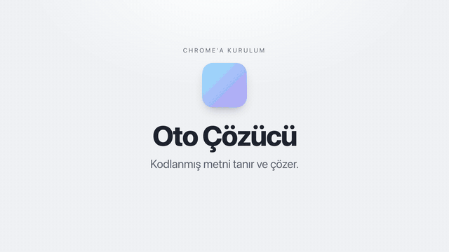
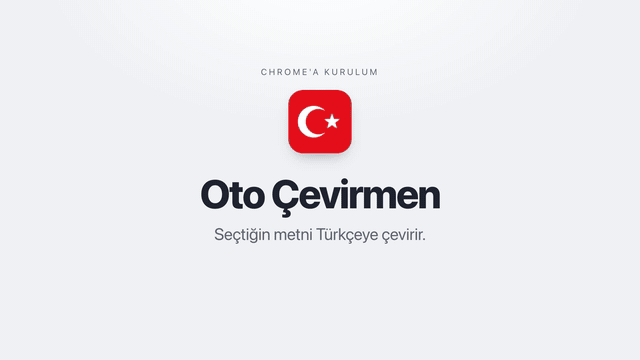
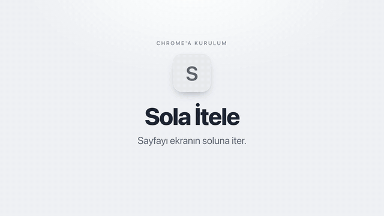
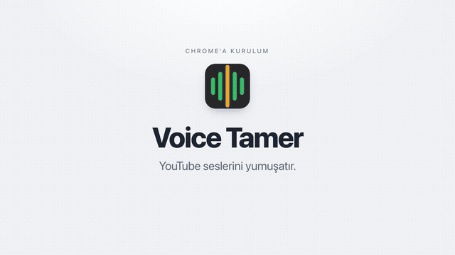

# Web Uzantıları

Chrome, Brave ve Edge için dört küçük tarayıcı uzantısı. Hesap, kayıt ya da API
anahtarı gerektirmezler; üçü hiç ağa çıkmaz.


| Uzantı | Ne yapar | Çalıştığı yer | Ağ | İndir |
|---|---|---|---|---|
| **[Oto Çözücü](oto-cozucu/)** | Kodlanmış ya da şifreli metni tanıyıp çözer, istersen kodlar: Base64, Hex, Morse, Vigenère, JWT, hash tanıma ve 30+ yöntem. | Tüm siteler | Yok | [oto-cozucu.zip](https://github.com/olcayalkan/web-uzantilari/releases/latest/download/oto-cozucu.zip) |
| **[Oto Çevirmen](oto-cevirmen/)** | Sayfada seçtiğin metni Türkçeye çevirip seçimin altında küçük bir balonda gösterir. | Tüm siteler | Google Translate | [oto-cevirmen.zip](https://github.com/olcayalkan/web-uzantilari/releases/latest/download/oto-cevirmen.zip) |
| **[Sola İtele](sola-itele/)** | Sayfanın içeriğini ekranın soluna iter, genişliği ayarlanabilir orana (varsayılan %70) sınırlar. | Tüm siteler | Yok | [sola-itele.zip](https://github.com/olcayalkan/web-uzantilari/releases/latest/download/sola-itele.zip) |
| **[Voice Tamer](voice-tamer/)** | YouTube seslerinde tiz, sibilans, gırtlak tınısı ve ani ses patlamalarını yumuşatır. | Yalnızca YouTube | Yok | [voice-tamer.zip](https://github.com/olcayalkan/web-uzantilari/releases/latest/download/voice-tamer.zip) |

## Kurulum

1. Yukarıdan istediğin uzantının zip'ini indir ve bir klasöre çıkar.
2. Uzantılar sayfasını aç: sağ üstteki **⋮** menüsü → **Uzantılar** → **Uzantıları yönet**
   (ya da adres çubuğuna `chrome://extensions`, `brave://extensions`, `edge://extensions`).
3. Sağ üstten **Geliştirici modu**'nu aç.
4. **Paketlenmemiş öğe yükle** düğmesine bas ve çıkardığın klasörü seç
   (içinde `manifest.json` olan klasör).
5. Uzantı yüklenmeden önce açık olan sekmeleri bir kez yenile.

Güncelleme, kaldırma ve sık sorunlar için: [docs/kurulum.md](docs/kurulum.md).

## Kurulum videoları

Her uzantı için Chrome menüsünden adım adım kurulum ve ilk kullanım. Önizlemeye tıklayınca tam çözünürlüklü video açılır (23 sn).

<table>
  <tr>
    <td align="center" width="50%">
      <a href="docs/videolar/oto-cozucu.mp4"></a>
      <br><b>Oto Çözücü</b> · <a href="docs/videolar/oto-cozucu.mp4">videoyu izle</a>
    </td>
    <td align="center" width="50%">
      <a href="docs/videolar/oto-cevirmen.mp4"></a>
      <br><b>Oto Çevirmen</b> · <a href="docs/videolar/oto-cevirmen.mp4">videoyu izle</a>
    </td>
  </tr>
  <tr>
    <td align="center" width="50%">
      <a href="docs/videolar/sola-itele.mp4"></a>
      <br><b>Sola İtele</b> · <a href="docs/videolar/sola-itele.mp4">videoyu izle</a>
    </td>
    <td align="center" width="50%">
      <a href="docs/videolar/voice-tamer.mp4"></a>
      <br><b>Voice Tamer</b> · <a href="docs/videolar/voice-tamer.mp4">videoyu izle</a>
    </td>
  </tr>
</table>

> Uzantılar Chrome Web Mağazası'nda değil; bu yüzden geliştirici modu gerekiyor.

## Gizlilik ve izinler

| Uzantı | İzinler | Veri nereye gider |
|---|---|---|
| Oto Çözücü | `contextMenus`, `clipboardRead`, `storage`, `notifications` | Hiçbir yere. Tüm çözme işlemi tarayıcıda yapılır. |
| Oto Çevirmen | `contextMenus`, `storage`, `translate.googleapis.com` | Seçilen metin çeviri için Google Translate'e gider. Başka yere gitmez. Hassas sayfalarda otomatik modu kapat. |
| Sola İtele | `storage` | Hiçbir yere. Sayfa içeriğini okumaz. |
| Voice Tamer | Yok | Hiçbir yere. Ayarlar YouTube'un yerel deposunda durur. |

Kod açık; her uzantının klasöründe ne yaptığı ve neden o izni istediği yazıyor.

## Geliştirici

```
oto-cozucu/              Her uzantı kökte kendi klasöründe,
oto-cevirmen/            kendi başına yüklenebilir
sola-itele/
voice-tamer/
  manifest.json
  icons/
  src/
    core/                Paylaşılan sabitler
    features/<özellik>/
      domain/            Saf iş mantığı: tarayıcı API'si yok, Node ile test edilir
      data/              Depolama, ağ, Web Audio gibi dış dünya bağdaştırıcıları
      presentation/      Popup ve sayfa içi arayüz
    background/          Service worker
  tests/
scripts/                 Paketleme, test, gizli bilgi taraması, manifest denetimi
docs/                    Kurulum, mimari, geliştirme
```

```bash
scripts/test.sh          # tüm testler (Chrome varsa tarayıcı testleri de)
scripts/gizli-tara.sh    # anahtar, token, kişisel yol taraması
scripts/paketle.sh       # dist/<ad>.zip
```

Katman kuralı ve yeni uzantı ekleme: [docs/mimari.md](docs/mimari.md),
[docs/gelistirme.md](docs/gelistirme.md).

## Lisans

[MIT](LICENSE). Kullanabilir, değiştirebilir, dağıtabilirsin; telif satırını koru.
