# Oto Çevirmen — Seçileni Türkçeye Çeviren Chrome Uzantısı

<a href="../docs/videolar/oto-cevirmen.mp4"></a>

Sayfada bir metni seçtiğinde dili otomatik algılar ve Türkçe çevirisini seçimin
altında küçük bir balonda gösterir. Düğmeye basmak, sağ tıklamak gerekmez.

## Kullanım

- **Metni seç.** Balon çeviriyle birlikte açılır (`İngilizce → Türkçe` gibi kaynak
  dil başlıkta yazar). **Kopyala** ile çeviriyi panoya al; Esc, dışarı tıklama ya
  da kaydırma balonu kapatır.
- **Aç / kapat.** Simgeye tıkla, sağ üstteki anahtarla otomatik çeviriyi aç ya da
  kapat (yanında **AÇIK** / **KAPALI** yazar). Popup açmadan da olur: simgeye sağ
  tıkla → **Seçince otomatik çevir**. Durum araç çubuğunda hep görünür: açıkken
  kırmızı simge + yeşil **AÇIK** rozeti, kapalıyken gri simge.
- **Elle çeviri.** Popup'taki kutuya yazınca çevirir (mod kapalıyken de).
- **Alt+Shift+T** ya da **sağ tık → "Türkçeye çevir"**: otomatik mod kapalıyken
  de seçimi çevirir. Content script'in çalışmadığı sayfalarda (chrome://, PDF)
  sağ tık seçimi popup'a aktarır.

Balon şu durumlarda açılmaz: metin zaten Türkçe, yalnızca sayı/sembol, tek bir
URL ya da e-posta adresi. Input/textarea içindeki seçimler de çevrilir.

## Kurulum (geliştirici modu)

1. Chrome'da `chrome://extensions` aç.
2. Sağ üstten **Geliştirici modu**'nu aç.
3. **Paketlenmemiş öğe yükle** → bu klasörü (`oto-cevirmen/`) ya da
   [Releases](https://github.com/olcayalkan/web-uzantilari/releases/latest)'tan indirip çıkardığın `oto-cevirmen` klasörünü seç.

Uzantı yüklenmeden önce açık olan sekmeleri bir kez yenile; content script yalnızca
yeni yüklenen sayfalara girer.

## Gizlilik

Seçilen metin çeviri için `translate.googleapis.com`'a gönderilir (Google
Translate'in anahtarsız uç noktası). Başka hiçbir yere veri gitmez; istek yalnızca
uzantının service worker'ından yapılır. Seçim özelliği için content script tüm
sayfalarda (`<all_urls>`) çalışır. Hassas sayfalarda popup'tan otomatik modu kapat.

Bu uç nokta resmî bir API değildir: Google çok sık istekte hız sınırı (HTTP 429)
uygular ve biçimi haber vermeden değiştirebilir. Balon böyle bir hatayı açıkça
gösterir.

## Proje yapısı

```
manifest.json                         # MV3
icons/                                # Simgeler (16/48/128)
tests/
├── test.js                           # Motor testleri (node tests/test.js)
├── sayfa-testi.html                  # content.js davranış testi (taklit chrome API)
└── calistir.sh                       # Sayfa testini görünmez Chrome'da çalıştırır
src/
├── core/
│   └── sabitler.js                   # Paylaşılan sabitler (depo anahtarları, sınırlar)
├── features/
│   └── ceviri/
│       ├── domain/
│       │   └── ceviri_motoru.js      # Saf mantık: süzme, parçalama, URL, yanıt çözme
│       ├── data/
│       │   ├── depolama.js           # chrome.storage sarmalayıcı (ayar + son seçim)
│       │   └── ceviri_servisi.js     # fetch + önbellek (yalnızca SW'de)
│       └── presentation/
│           ├── content/content.js    # Sayfa-içi balon (kapalı Shadow DOM)
│           └── popup/                # popup.html / .css / .js
└── background/
    └── service_worker.js             # Mesaj köprüsü, sağ tık menüsü, kısayol
```

**Katman kuralı:** `domain` saf, chrome API'si yok, Node ile test edilir. Ağ çağrısı
yalnızca `data/ceviri_servisi.js` üzerinden ve yalnızca service worker'da yapılır;
content script'ten yapılan fetch sayfanın CSP'sine takılırdı.

5000 karakterden uzun seçim çevrilmez. Uzun metin cümle sınırlarından ~1500
karakterlik parçalara bölünüp sırayla çevrilir. Son 200 çeviri bellekte tutulur.

## Test ve paketleme

```bash
node tests/test.js        # motor testleri (çevrimdışı)
node tests/test.js --ag   # + gerçek uç nokta denemesi
tests/calistir.sh         # content.js, görünmez Chrome'da
../scripts/paketle.sh     # depo kökünde dist/oto-cevirmen.zip
```
