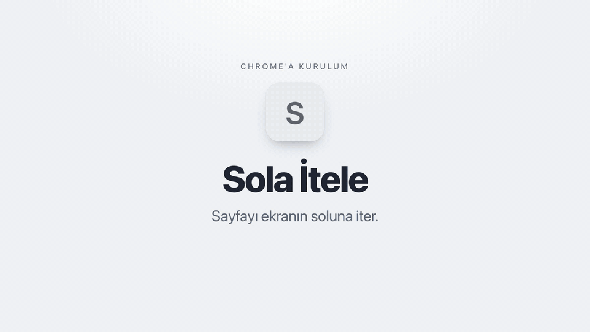

# Sola İtele

<a href="../docs/videolar/sola-itele.mp4"></a>

Web sayfalarının tüm içeriğini ekranın soluna iten Chrome eklentisi. Sayfa, pencere genişliğinin ayarlanan oranı kadar yer kaplar (varsayılan %70) ve sağ taraf boş kalır. İçerik silinmez, küçültülmez.

## Dosya yapısı

```
sola-itele/
├── manifest.json                       Eklenti tanımı (Manifest V3)
├── docs/                               kurulum, kullanım, mimari, geliştirme
├── src/
│   ├── core/sabitler.js                Depo anahtarları, varsayılan oran, gecikme
│   ├── features/itele/
│   │   ├── domain/itele_motoru.js      Saf hesap: kök CSS + fixed öğe yerleşimi
│   │   ├── data/depolama.js            chrome.storage sarmalayıcı
│   │   └── presentation/
│   │       ├── content/content.js      Ölçer, stili uygular, geri alır
│   │       └── popup/                  popup.html / .css / .js
│   └── background/service_worker.js    Simge rozetini (AÇIK) günceller
└── tests/
    ├── test.js                         Domain testleri (node tests/test.js)
    ├── sayfa-testi.html                Gerçek sayfada davranış testi
    └── calistir.sh                     Sayfa testini görünmez Chrome'da çalıştırır
```

## Hızlı başlangıç

1. `chrome://extensions` sayfasını açın, **Geliştirici modu**nu açın.
2. **Paketlenmemiş öğe yükle** ile bu klasörü ya da [Releases](https://github.com/olcayalkan/web-uzantilari/releases/latest)'tan indirip çıkardığınız `sola-itele` klasörünü seçin.
3. Araç çubuğundaki simgeye tıklayın, anahtarı açın ve oranı seçin.

Ayrıntılar için [docs/](docs/) klasörüne bakın.
